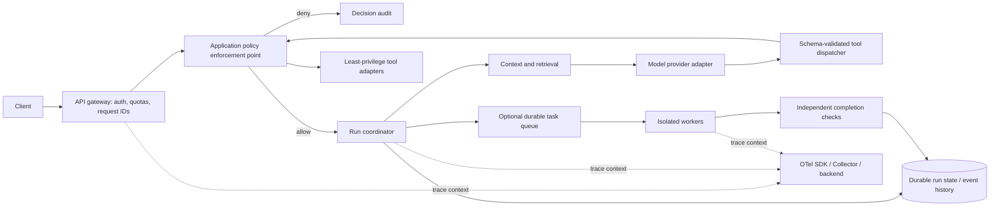

# Deployment Reference Architectures

This document connects the labs to common production architecture shapes. These are implementation options and operational questions, not components deployed by this repository. No Kubernetes cluster, broker, model provider, OPA service, OpenTelemetry Collector, or external database is configured here.

## Request-path composition

This shape intentionally puts authorization around each actual side effect, not only at request admission. If work is queued, the worker must re-check current authorization and handle expired identity or policy. Completion verification should read the resulting state through a trustworthy path.

## Architecture options and tradeoffs

| Shape | Good fit | Costs and failure modes | Lab relation |
|---|---|---|---|
| Modular monolith | One owner/team, shared transactions, early product development | Shared process failures; module boundaries can erode | The repository is organized as local packages, but the labs are independently installable artifacts |
| Hexagonal / ports and adapters | Provider or storage replacement; deterministic tests | More interfaces and wiring; abstraction can become ceremony | Several labs inject callables/connections, but none claims a complete architecture |
| Supervisor-worker | Bounded parallel tasks with clear acceptance criteria | Context loss, partial completion, retry storms, lost handoffs | Handoff lab validates a typed envelope; it has no worker service or queue |
| DAG / durable workflow | Long-running tasks, waits, approvals, retries across process restarts | History growth, deterministic replay constraints, versioning and operations burden | Recovery lab reconstructs a small JSONL state; it does not resume workflow code |
| Event-driven with outbox/inbox | Reliable delivery from transactional state changes to consumers | At-least-once delivery, deduplication, poison messages, ordering | Idempotency lab stores a local result only; it has no relay or message broker |
| PDP/PEP authorization | Central policy management with enforcement in each service | Policy availability, caching/revocation consistency, identity propagation | Permissions lab shows a local allowlist gate; OPA is a documented option, not included |
| Container/VM worker isolation | Running untrusted or tenant code | Image lifecycle, kernel/runtime boundary, escape risk, quotas and networking | Sandbox lab runs trusted fixtures only; it is not safe for hostile code |

## A reasonable evolution path

1. Start with one coordinator process and explicit adapter interfaces. Keep policy, schema validation, idempotency, verification, budgets and trace IDs as non-optional boundaries.
2. Move long-running state to a durable store and define event versions and recovery semantics before adding a queue.
3. Add a transactional outbox when a committed state change must reliably publish work; make consumers idempotent.
4. Split workers when isolation, independent scaling or ownership makes a process boundary worthwhile. Carry request, run, task and trace identifiers across that boundary.
5. Add external policy, secrets, telemetry and sandbox platforms only with explicit failure behavior, retention and operational ownership.

## Patterns this lab does not claim

- It does not provide exactly-once distributed execution. The local SQLite transaction is scoped to one database connection/database file.
- It does not implement Temporal workflow replay. Durable engines record commands/results and impose replay constraints; see the [Temporal workflow documentation](https://docs.temporal.io/workflows#durable-execution).
- It does not implement LangGraph persistence. LangGraph distinguishes thread-scoped checkpoints from cross-thread stores; see [persistence concepts](https://docs.langchain.com/oss/python/langgraph/persistence).
- It does not export OpenTelemetry. Trace IDs and parent IDs here are a teaching representation; see [OpenTelemetry traces](https://opentelemetry.io/docs/concepts/signals/traces/).
- It does not run OPA/Rego. The OPA docs describe policy decision decoupling and structured inputs; see [OPA documentation](https://www.openpolicyagent.org/docs/latest/).
- It does not enforce Kubernetes isolation. Security contexts are one part of container configuration; see [Kubernetes security contexts](https://kubernetes.io/docs/tasks/configure-pod-container/security-context/).

Use [the architecture catalog](architecture-catalog.md) to map each concern to its local project and [the validation record](validation-record.md) for what was actually executed.
