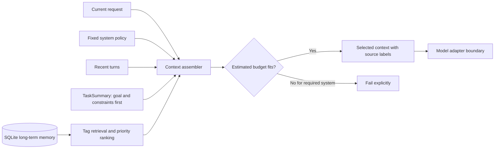
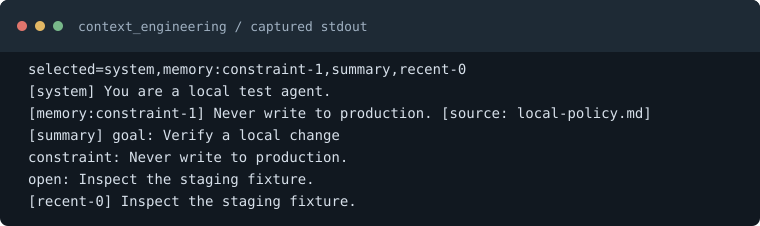

# Context workbench

The context window is a budgeted input, not a memory store. This lab separates fixed instructions, a compact task summary, recent turns and durable facts retrieved from SQLite. Required system context fails loudly if it cannot fit; tagged facts are priority-ranked and inserted before optional summary and recent details. Persisted facts carry a `source` label into assembled context.

## Run the path

```powershell
python -m examples.context_engineering.demo
python -m pytest examples/context_engineering -q
```

Standalone install from this directory: `python -m pip install -e ".[test]"`; the installed command is `context-memory-demo`.

The demo writes a local memory record, closes the database, reopens it, retrieves the safety fact, and assembles context. It uses a character-based token estimate for deterministic tests; it does not call a model tokenizer or model API.

## Architecture and evidence



Editable diagram source: [overview.mmd](architecture/overview.mmd). The project tests cover context-budget overflow, memory ranking, source provenance, summary priority, persistence across connections, and invalid budgets.

The regression suite caught optional summary content consuming space before a high-priority safety memory. Moving retrieved memories ahead of optional material fixed that case. A separate Windows run caught SQLite handles left open by connection context managers; explicit connection closing made temporary-database cleanup succeed.



Raw captured command, exit code, stdout and stderr: [run.json](evidence/run.json).

## Production delta

Replace the estimator with the exact tokenizer for the selected model. Add user/tenant scoping, memory lifecycle and deletion, retrieval quality evaluations, stale-fact policy, prompt-injection handling for retrieved text, and model-specific context limits before deployment.
