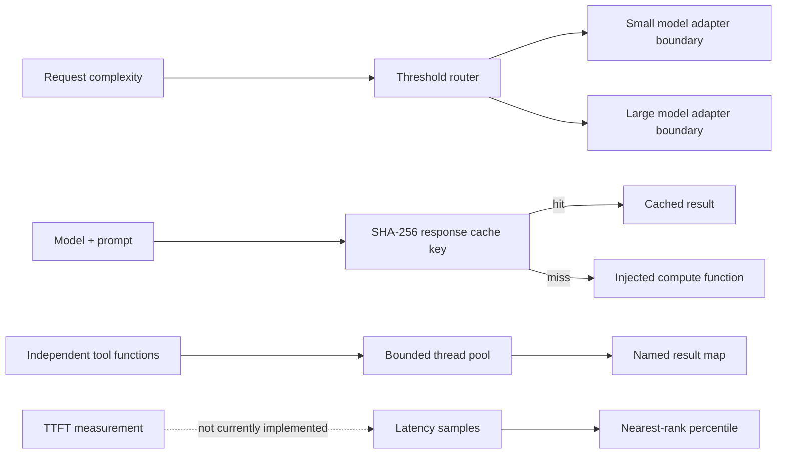

# Routing and Latency Bench

Four deterministic components live here: complexity-threshold routing, SHA-256 cache key construction, parallel execution of independent callables, and nearest-rank percentile selection. Injected functions keep the demo offline; there is no model SDK or provider call.



Editable diagram source: [overview.mmd](architecture/overview.mmd).

## Demo snapshot

```text
python -m examples.economics.demo
python -m pytest examples/economics -q
```

Install independently from this directory with `python -m pip install -e ".[test]"`; the CLI is `economics-demo`.

The fixed fixture prints `route=small cache_hits=1 tools=2 p95_ms=50`. The percentile is calculated from a hard-coded five-value sample; it is not measured latency. The tests cover cache key separation, routing boundaries, tool exceptions, invalid worker counts, finite percentile inputs and endpoints.

### Production measurement plan

Include model, prompt, policy/config and tenant scope in cache keys where appropriate; define privacy and freshness rules before caching. Measure queue wait, time-to-first-token (TTFT), tool latency and end-to-end latency separately. Compute P50/P95/P99 from sufficient representative samples and segment by route/model/task. Compare output quality and failure rate with token and infrastructure cost. This lab implements none of the provider metrics or routing adapters.


Machine-readable run record: [run.json](evidence/run.json).
