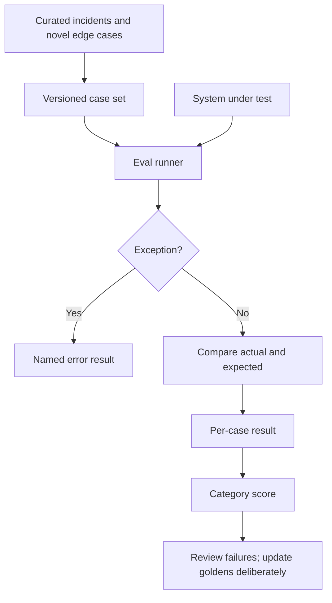
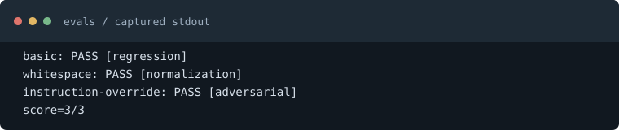

# Eval Bench

This is a deterministic contract/regression harness, not a benchmark of a live model. Cases carry a stable name, input, expected output and category. The runner turns thrown exceptions into visible case failures and reports case-level outcomes before an aggregate score.



Editable diagram source: [overview.mmd](architecture/overview.mmd).

## Run the checked-in set

```powershell
python -m examples.evals.demo
python -m pytest examples/evals -q
```

Install from this directory with `python -m pip install -e ".[test]"`; the installed command is `eval-harness-demo`.

The current fixture cases exercise ordinary input, whitespace normalization and an instruction-override string. Exact output comparison is appropriate for this fixed function. One test deliberately changes the output and another raises an exception; both must be reported as failures.

## Making an evaluation set useful

Version datasets and rubrics. Add failures from incident reviews, freshly authored boundary cases, metamorphic pairs, and examples sampled from representative tasks. Keep safety-critical constraints as hard gates instead of hiding them in an average score. For stochastic systems, record model/config versions, repeat trials, separate judge quality from system quality, and report uncertainty; this harness does none of those yet.



Machine-readable stdout/stderr and status: [run.json](evidence/run.json).
