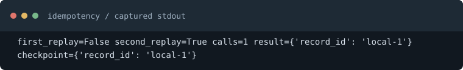

# Idempotency Ledger

A retry can arrive after a write committed but before its response reached the caller. The local SQLite ledger uses a primary-key idempotency key and stores the result in the same transaction as the callback to demonstrate the replay contract.

## Transaction walkthrough

```mermaid
sequenceDiagram
	participant Client
	participant Store as SQLite transaction
	participant Op as Local operation
	Client->>Store: execute_once(key)
	Store->>Store: BEGIN IMMEDIATE; lookup key
	alt key already recorded
		Store-->>Client: Stored result, replay=true
	else new key
		Store->>Op: Execute inside transaction
		Op-->>Store: Result mapping
		Store->>Store: Insert key and result; COMMIT
		Store-->>Client: Result, replay=false
	end
```

Editable sequence source: [overview.mmd](architecture/overview.mmd).

A first request returns `(result, False)`. A repeat with the same key returns the stored result and `(result, True)` without invoking the callback again. Checkpoints are separately upserted by `(run_id, step)` and survive wrapper reconstruction over the same database.

Run `python -m examples.idempotency.demo`; test with `python -m pytest examples/idempotency -q`. Cases cover one-time execution, replay, callback rollback, persisted checkpoint reads, upsert scope, invalid keys/results and non-JSON checkpoint values.

Standalone install from this directory: `python -m pip install -e ".[test]"`; installed command: `idempotency-demo`.



Structured execution record: [run.json](evidence/run.json).

## Failure boundary: remote side effects

The SQLite transaction cannot include a remote HTTP request or message-broker publish. A timeout after a remote write is ambiguous. Production designs commonly propagate a provider-supported idempotency key or use an outbox/inbox plus reconciliation. This lab does not implement a distributed transaction, outbox relay, retention/expiry, or concurrent multi-process service. See the [AWS idempotent API discussion](https://aws.amazon.com/builders-library/making-retries-safe-with-idempotent-APIs/).
