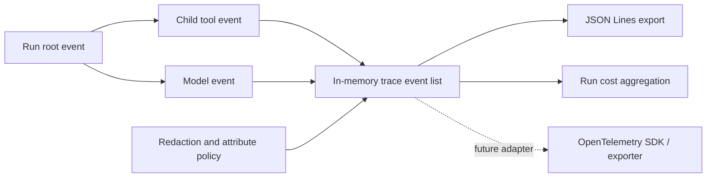
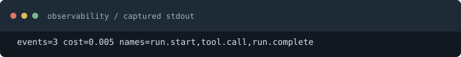

# Trace Reading Room

The local trace recorder emits ordered JSONL events with a trace ID, span ID, optional parent, timestamp and scalar attributes. Its demo creates one root event and two children, then totals the `cost` attributes. This is intentionally a small in-memory object, not OpenTelemetry instrumentation.

Editable diagram source: [overview.mmd](architecture/overview.mmd).

## Observe it

Run `python -m examples.observability.demo`. It prints the stable event count, cost and event names. `Trace.to_jsonl()` still exports timestamped records for downstream inspection. Check the boundaries with `python -m pytest examples/observability -q`.

Standalone install from this directory: `python -m pip install -e ".[test]"`; installed command: `trace-demo`.

The tests cover parent linkage, JSON structure, empty names, missing parents, negative/non-finite costs and nested attribute rejection. These are local contract checks; they do not prove exporter delivery or distributed context propagation.

### If this becomes a service

Use OpenTelemetry's tracer/provider/exporter lifecycle, propagate trace context across service and queue boundaries, standardize semantic attributes, and select sampling/retention with privacy controls. Record tool name, redacted argument summaries, latency, status, retries and spend. Avoid credentials and sensitive prompt bodies. The official [trace concepts](https://opentelemetry.io/docs/concepts/signals/traces/) describe span context and propagation; this lab does not emit OTLP.

Captured command and output: [run.json](evidence/run.json).
