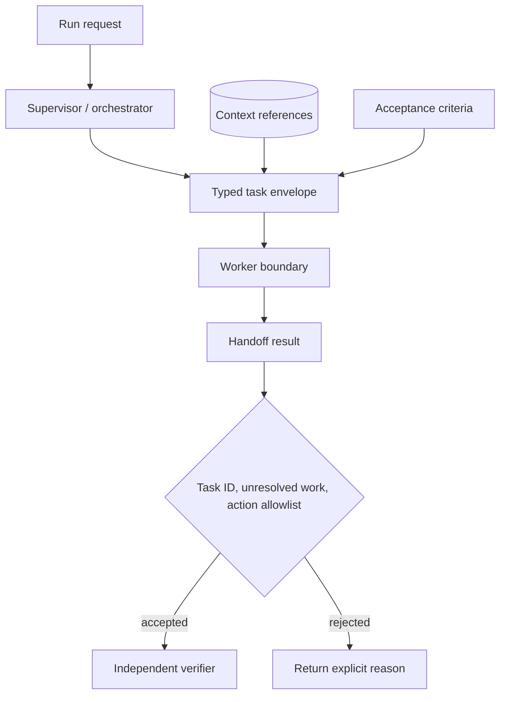
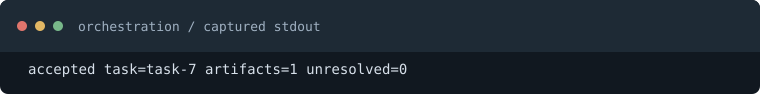

# Handoff Contract

## The workflow in one request

An orchestrator packages objective, task ID, allowed actions, acceptance criteria and context references into a typed envelope. A worker returns a task ID, summary, artifact references, unresolved items and declared actions. The acceptor rejects mismatched IDs, empty summaries, unresolved work and actions outside the declared allowlist.



Editable diagram source: [overview.mmd](architecture/overview.mmd).

### Quick run

```powershell
python -m examples.orchestration.demo
python -m pytest examples/orchestration -q
```

For standalone use, install from this directory with `python -m pip install -e ".[test]"`; the console command is `handoff-demo`.

Tests show valid acceptance and rejection for task mismatch, empty result, unresolved items, missing criteria and unauthorized declared actions. The successful demo reports `accepted task=task-7 artifacts=1 unresolved=0`.

### What worked / what remains

Typed handoffs make scope and acceptance criteria inspectable at a boundary. The action list is only a declaration checked after the worker returns; it does not prevent the worker from performing an action. Enforce permissions at each actual tool/resource boundary. The acceptor also does not verify artifact contents; connect it to independent postcondition checks.

This is a synchronous supervisor-worker contract, not a distributed queue. A production queue typically needs durable task state, lease/visibility timeouts, retry policy, dead-letter handling, cancellation, tracing context and payload versioning. The architecture catalog compares the workflow with durable workflow and event-driven patterns.



Captured command and output: [run.json](evidence/run.json).
