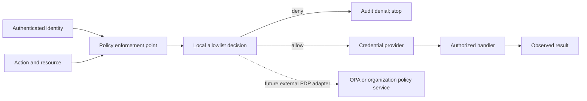

# Authorization Boundary Lab

**Question:** can a denied action reach the credential provider?

The executable answer is tested, not inferred from prompt text. `guarded_operation` authorizes first. Only the allow branch invokes the credential loader; the tests assert that a denied production write never calls it. The fixture credential is a fake local string and no environment variable is read.

### Run locally

`python -m examples.permissions.demo`

The demo shows one permitted fixture read and a denial for `write_production`. Run the test slice with `python -m pytest examples/permissions -q`.

Standalone install from this directory: `python -m pip install -e ".[test]"`; installed command: `authorization-demo`.

### Deployment mapping

The diagram distinguishes a policy decision point (PDP) from a policy enforcement point (PEP). The in-process `Policy` is only a local allowlist; it is not OPA, IAM, OAuth, or a credential manager. OPA documents a separate policy evaluation API over structured input; Kubernetes documents container security contexts. Neither is configured here.

Editable diagram source: [overview.mmd](architecture/overview.mmd).

### Tested properties

- Unlisted actions are denied rather than inferred from related permissions.
- The credential loader is not called after denial.
- A credential-provider exception prevents the operation callback from running.

Captured stdout and process status: [run.json](evidence/run.json).

Bind real decisions to authenticated principal, resource, environment and policy version. Add auditable decision records, revocation behavior, secret-manager integration and least-privilege credential scopes. Keep secrets out of model context and telemetry. These are deployment requirements, not implemented claims.
