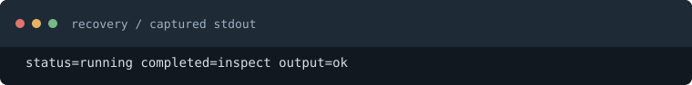

# Reconstruct a Run

The recovery project uses an append-only JSONL event history. `reconstruct(path)` starts from `pending` and replays `started`, `step_completed`, `failed`, and `completed` events. It restores status, completed step names and output values, while rejecting malformed records, unknown event types and impossible transitions.

```mermaid
stateDiagram-v2
	[*] --> Pending
	Pending --> Running: started event
	Running --> Running: step_completed event
	Running --> Failed: failed event
	Running --> Completed: completed event
	Running --> Reconstructed: process restarts; replay log
	Reconstructed --> Running: caller resumes unfinished work
	Failed --> Reconstructed: operator recovery policy
	Completed --> [*]
```

Editable state diagram source: [overview.mmd](architecture/overview.mmd).

## Try interruption/replay

`python -m examples.recovery.demo` creates a temporary log, records a start and a completed step, then reconstructs a `running` state. Tests cover a missing log, repeated reconstruction, a completed run, corrupt JSON and invalid transitions.

Install this lab independently from its directory with `python -m pip install -e ".[test]"`; run the console command `run-recovery-demo`.

The replay function reconstructs state only. It does not resume or execute unfinished work. That distinction matters: Temporal documents deterministic workflow replay using recorded history and recorded activity results; this JSONL lab is not a Temporal-compatible event history or workflow engine.

## Operations still required for durable use

Version event schemas and migration rules. Choose and test append atomicity and flush/fsync guarantees. Serialize concurrent writers or use a transactional database. Add idempotency around effects, event retention, integrity checks and operator-driven reconciliation for ambiguous effects. Current tests validate parser/state behavior, not crash durability under power loss.

Raw execution record: [run.json](evidence/run.json).
