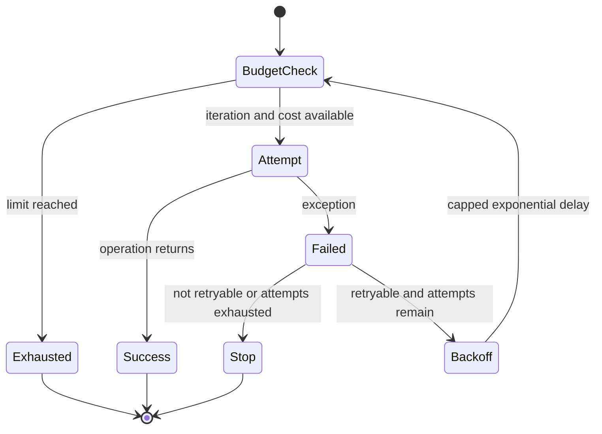

# Retry Budget Lab

Retries are controlled by two decisions: whether a failure is retryable, and whether the run can still pay for another attempt. This lab injects the operation, retry predicate, sleeper and budget so tests can observe each attempt without waiting.

## State path



Editable state-machine source: [overview.mmd](architecture/overview.mmd).

The loop applies capped exponential delays and accounts for every attempt against iteration and optional cost ceilings. An optional injected jitter function can vary each wait, but its result must remain between zero and the current delay ceiling. Invalid negative or non-finite budget/delay values are rejected before the operation runs.

```powershell
python -m examples.retry_budgets.demo
python -m pytest examples/retry_budgets -q
```

To install this lab independently, run `python -m pip install -e ".[test]"` from this directory. The console entry point is `retry-budget-demo`.

Tested cases include transient recovery, non-retryable stop, max-attempt and iteration exhaustion, per-attempt cost exhaustion, bounded injected jitter, invalid configuration and delay capping.

### A test that failed for the wrong reason

An early test named a `ValueError` “non-retryable” but supplied a predicate that returned `True` for every exception. It correctly retried five times. Correcting the fixture made the intended contract explicit; the retry loop did not need a production change for that test.


Exact execution record: [run.json](evidence/run.json).

This is not a network client. It has no request timeout/deadline, random jitter source, server-directed retry delay, cancellation, circuit breaker, or idempotency protection. Supply a suitable jitter strategy at the integration boundary. AWS's [retry and jitter discussion](https://aws.amazon.com/builders-library/timeouts-retries-and-backoff-with-jitter/) describes further concerns; this local lab implements only capped exponential delay, optional injected jitter and budget checks.
