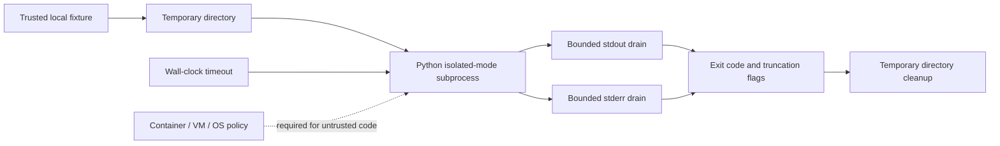

# Trusted Fixture Runner

The executable path creates a temporary directory, writes a supplied Python fixture, launches the configured interpreter in isolated mode, drains stdout/stderr concurrently while retaining only the configured byte limits, enforces a timeout, and returns exit status plus truncation flags.

| Check | Expected contract |
|---|---|
| Working directory | Fresh temporary directory |
| Timeout | Child is killed and `subprocess.TimeoutExpired` is raised |
| Output | Bounded bytes retained per stream; truncation marked |
| Process failure | Nonzero exit code and bounded stderr returned |

Run `python -m examples.sandbox.demo`; run tests with `python -m pytest examples/sandbox -q`. The suite exercises both output streams with large writes, timeout, nonzero exit, bad bounds and temporary working-directory behavior.

Standalone install from this directory: `python -m pip install -e ".[test]"`; installed command: `fixture-runner-demo`.

Editable diagram source: [overview.mmd](architecture/overview.mmd).

## Security warning

This is not a security sandbox. Python isolated mode, a temporary directory, a subprocess and a timeout do not constrain filesystem access, syscalls, network access, resource consumption outside captured output, or host escape. Run trusted fixtures only. For untrusted workloads, use a dedicated container or VM with an unprivileged identity, read-only base, CPU/memory/PID quotas, syscall and filesystem restrictions, network denied by default, disposable storage, and no credentials. Kubernetes security contexts can express some container identity and privilege settings, but they are one layer of a deployment.

Captured process record: [run.json](evidence/run.json).
