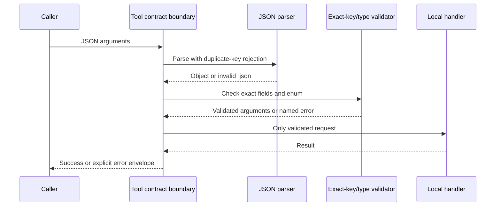
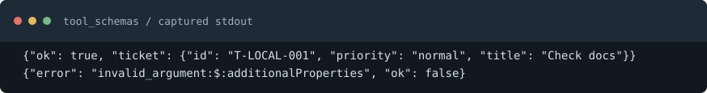

# Tool Contract Boundary

This project treats tool arguments as an API request. It parses JSON, rejects duplicate object keys, requires an exact field set, validates types/enums, normalizes the title and returns a discriminated success/error envelope. A handler receives values only after validation.

| Field | Contract |
|---|---|
| `title` | Non-empty string after trimming |
| `priority` | One of `low`, `normal`, `high` |
| Additional fields | Rejected |

From the monorepo root run `python -m examples.tool_schemas.demo`; run this lab's tests with `python -m pytest examples/tool_schemas -q`. The demo includes accepted and rejected requests. Tests cover malformed JSON, wrong top-level type, missing/extra keys, invalid field types, enum failures, empty values, and duplicate keys.

As a standalone project, install from this directory with `python -m pip install -e ".[test]"`; its CLI is `tool-contract-demo`.

Editable diagram source: [overview.mmd](architecture/overview.mmd).

Full captured process record: [run.json](evidence/run.json).

The contract files live under `schemas/` and use JSON Schema Draft 2020-12. The lab validates both arguments and results with `jsonschema`, while retaining a custom duplicate-key rejection during JSON parsing. The schema does not expose a network endpoint, authenticate a caller, or integrate an API provider. See the [JSON Schema guide](https://json-schema.org/learn/getting-started-step-by-step) and [function calling guide](https://developers.openai.com/api/docs/guides/function-calling).
