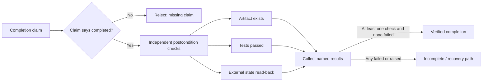

# Completion Gate

**Acceptance rule:** a completion claim is necessary but not sufficient. Every check runs independently; false returns and raised exceptions are named failures. Empty check sets cannot produce success.



Editable diagram source: [overview.mmd](architecture/overview.mmd).

Use the local verifier:

```text
python -m examples.verification.demo
python -m pytest examples/verification -q
```

Install independently from this directory with `python -m pip install -e ".[test]"`; its CLI is `completion-check-demo`.

The demo verifies `artifact_exists` and `tests_pass`, then prints the names that passed. Tests also cover a false check, an exception, no checks, and a missing completion claim. The check runner intentionally isolates each check's exception so one failed postcondition does not hide later results.

### Checklist for adapting this boundary

- Prefer observable postconditions such as a persisted record read-back, output hash, test report or downstream acknowledgement.
- Keep the verifier's identity and read path independent from the component making the claim.
- Record the subject, expected value, observed value, timestamp and verifier version for auditability.
- Define whether failure triggers retry, human review, compensation or a terminal failure.

This module returns an in-memory result only. It does not sign attestations, verify deployment state, store evidence or guarantee checks are independent; the caller must select trustworthy check functions.


Exact execution record: [run.json](evidence/run.json).
